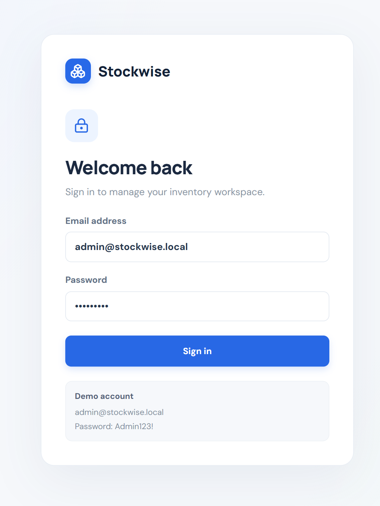
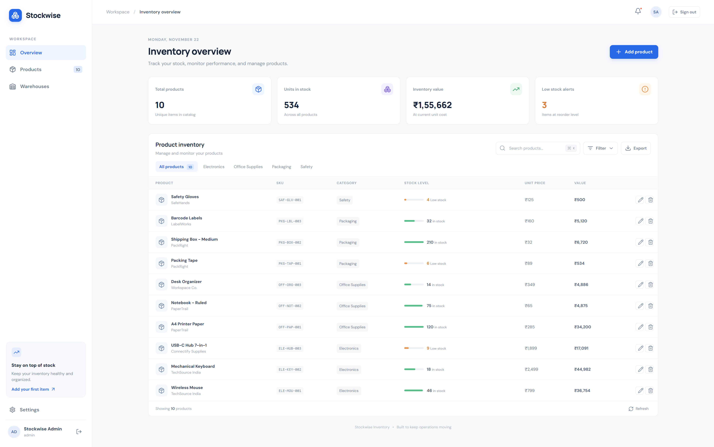
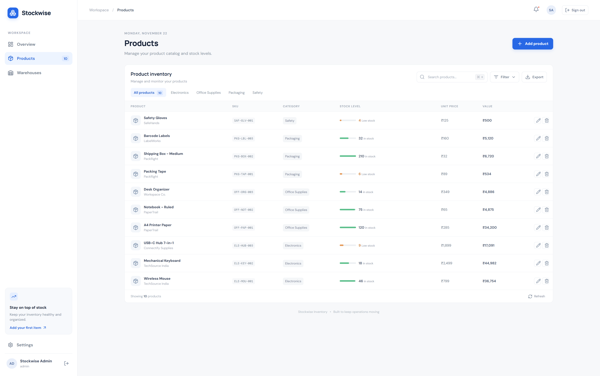
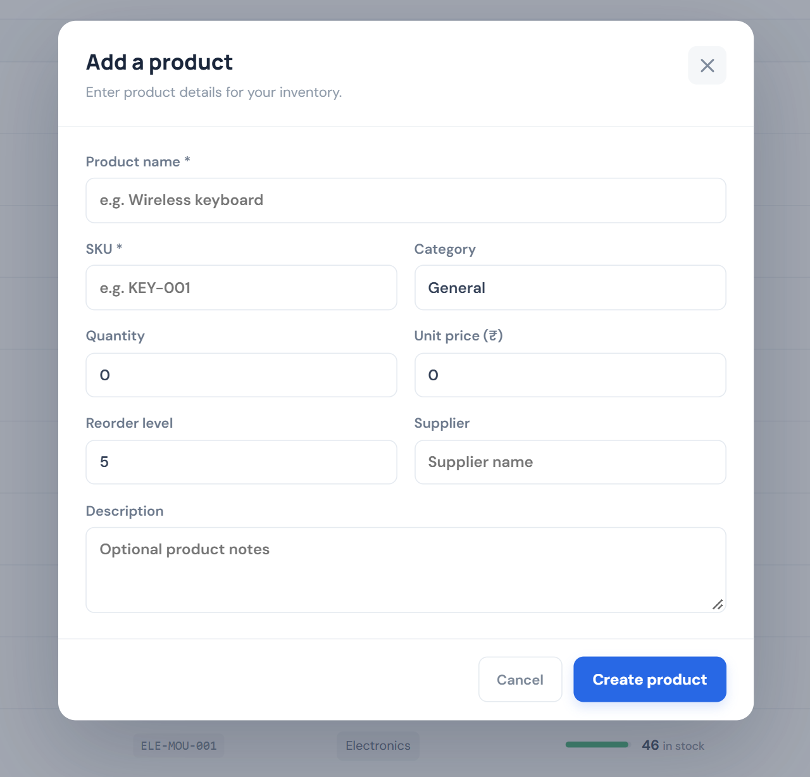
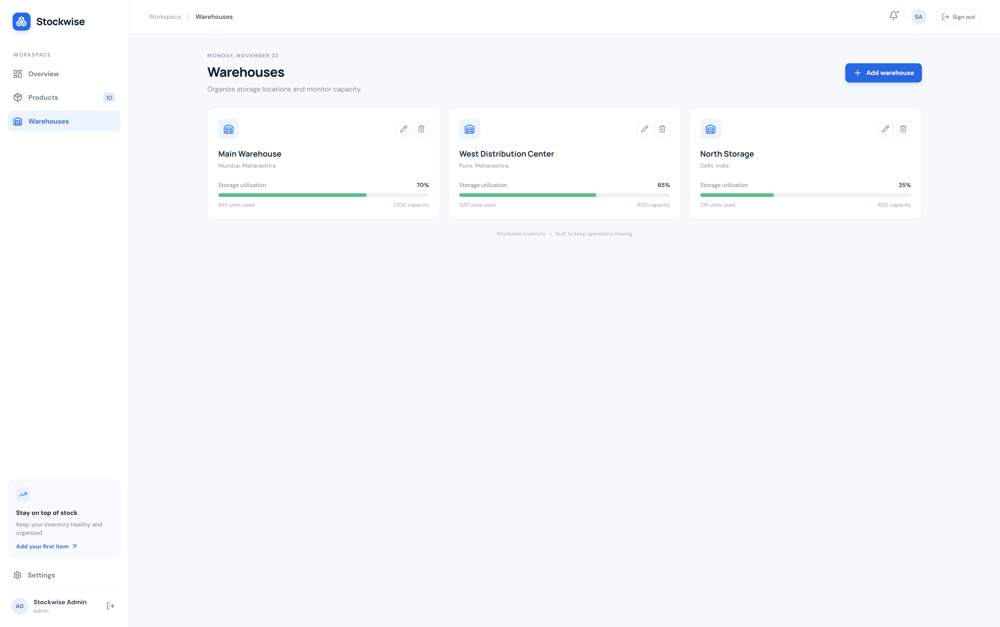
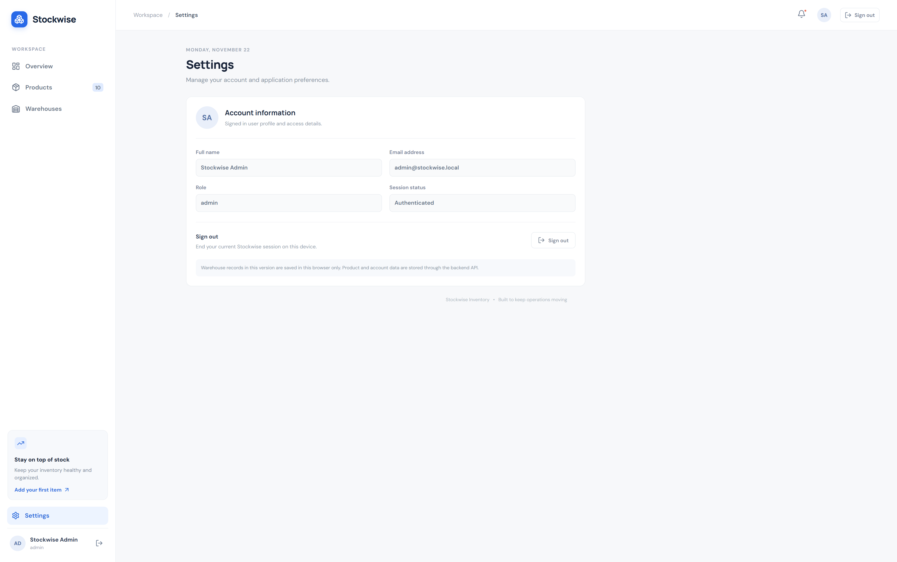

# 📦 Stockwise – Inventory Management System

<p align="center">
  
  
  
  
  
  
  
</p>

Stockwise is a full-stack Inventory Management System built using the MERN stack. It helps businesses manage products, monitor stock levels, organize warehouses, and track inventory efficiently through a clean and responsive dashboard.

## 📸 Screenshots

<!-- Replace the image paths below with your actual screenshot paths -->

### 🔐 Login Page



### Dashboard



### Products Management



### 📦 Add Product



### Warehouse Management



### Settings



## ✨ Features

### 🔐 Authentication

- Secure user login using JWT authentication.
- Protected application routes and APIs.
- Password hashing for secure credential storage.
- Persistent login sessions.
- Logout functionality.

### 📊 Dashboard

- Overview of total products.
- Total inventory quantity.
- Inventory value summary.
- Low-stock alerts.
- Inventory statistics.

### 📦 Product Management

- Add new products.
- Edit existing product details.
- Delete products.
- Search products.
- Filter products by category.
- Manage stock quantities.
- Monitor reorder levels.
- Export inventory data to CSV.

### 🏢 Warehouse Management

- View warehouse information.
- Add new warehouses.
- Edit warehouse details.
- Delete warehouses.
- Manage warehouse locations and capacities.

### ⚙️ Settings

- View account information.
- Manage application session.
- Access account-related settings.

### 🌱 Sample Data

- Seed script for generating demo inventory data.
- Preconfigured administrator account.
- Sample products and categories.
- Example warehouse records.

### 📱 Responsive Design

- Clean dashboard interface.
- Responsive layouts.
- Sidebar navigation.
- Active navigation highlighting.

## 🛠️ Tech Stack

| Technology | Purpose                             |
| ---------- | ----------------------------------- |
| React.js   | Frontend user interface             |
| Vite       | Frontend development and build tool |
| JavaScript | Application logic                   |
| CSS3       | Styling and responsive design       |
| Node.js    | Backend runtime                     |
| Express.js | REST API development                |
| MongoDB    | Database                            |
| Mongoose   | MongoDB object modeling             |
| JWT        | Authentication                      |
| bcrypt     | Password hashing                    |
| Axios      | API communication                   |

## 📁 Project Structure

```text
inventory-management-system-mern/
│
├── client/
│   ├── public/
│   └── src/
│       ├── components/
│       ├── pages/
│       ├── assets/
│       ├── App.jsx
│       ├── main.jsx
│       └── ...
│
├── server/
│   ├── config/
│   ├── controllers/
│   ├── middleware/
│   ├── models/
│   ├── routes/
│   ├── scripts/
│   ├── server.js
│   └── .env.example
│
├── package.json
└── README.md
```

_Note: The structure above is a representative overview. Adjust folder names if your local project differs._

## ⚙️ Installation & Setup

### 1. Clone the Repository

```bash
git clone https://github.com/ajinkya029/inventory-management-system-mern.git
```

### 2. Navigate to the Project

```bash
cd inventory-management-system-mern
```

### 3. Install Dependencies

Install all project dependencies:

```bash
npm run install:all
```

If this script is unavailable, install dependencies separately:

```bash
npm install
npm install --prefix server
npm install --prefix client
```

### 4. Configure Environment Variables

Create a `.env` file inside the `server` directory.

```env
PORT=5000
MONGO_URI=mongodb://127.0.0.1:27017/inventory_management
JWT_SECRET=your_secure_jwt_secret
```

Make sure MongoDB is running before starting the backend.

### 5. Seed Sample Data

Run the seed script to populate the database with demo products and an administrator account.

```bash
npm run seed --prefix server
```

### 6. Start the Application

```bash
npm run dev
```

The application will be available at:

**Frontend:** http://localhost:5173

**Backend:** http://localhost:5000

## 🔑 Demo Login Credentials

Use the following credentials to explore the application:

| Field    | Value                 |
| -------- | --------------------- |
| Email    | admin@stockwise.local |
| Password | Admin123!             |

**Note:** Change the demo password and JWT secret before deploying the application.

## 🔌 API Endpoints

### Authentication

| Method | Endpoint          | Description            |
| ------ | ----------------- | ---------------------- |
| POST   | `/api/auth/login` | Authenticate user      |
| GET    | `/api/auth/me`    | Get authenticated user |

### Products

| Method | Endpoint                   | Description              |
| ------ | -------------------------- | ------------------------ |
| GET    | `/api/products`            | Get all products         |
| GET    | `/api/products/stats`      | Get inventory statistics |
| GET    | `/api/products/categories` | Get product categories   |
| POST   | `/api/products`            | Add a product            |
| PUT    | `/api/products/:id`        | Update a product         |
| DELETE | `/api/products/:id`        | Delete a product         |

_Verify endpoint names against your actual backend routes before publishing._

## 🚀 Future Improvements

- User registration.
- Role-based access control (Admin and Staff).
- MongoDB-backed warehouse management.
- Assign products to warehouses.
- Transfer stock between warehouses.
- Inventory transaction history.
- Advanced analytics and reporting.
- Email notifications for low-stock alerts.
- Password change and profile management.

## 🤝 Contributing

Contributions, issues, and feature requests are welcome!

1. Fork the repository.
2. Create a feature branch.
3. Commit your changes.
4. Push the branch.
5. Open a Pull Request.

## 📄 License

This project is open-source and available under the MIT License.

## 👨‍💻 Author

**Ajinkya Dhatrak**

GitHub: [@ajinkya029](https://github.com/ajinkya029)

---

<p align="center">
  <b>Built with ❤️ using the MERN Stack</b>
</p>
